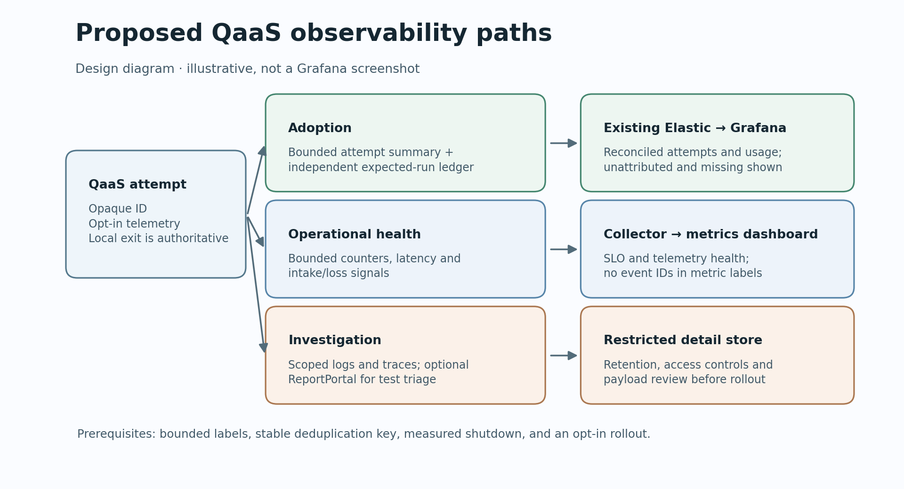
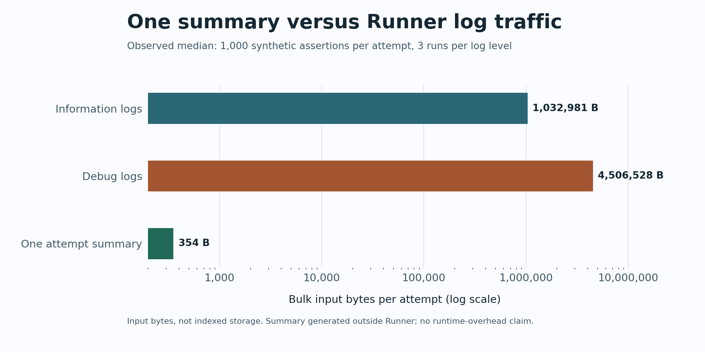

# QaaS observability: local evidence and rollout boundaries

**Status: proposal backed by controlled local experiments.** This is a reconstructed summary of recorded results. The earlier runtime, raw traces, and report files are not available in the current workspace. No synthetic record here is presented as a real tenant, Grafana screenshot, production benchmark, or live deployment result.

## Start with Elastic, add signals when they answer a different question

Use the existing Elastic-to-Grafana path for adoption and usage. A bounded, versioned terminal summary per instrumented attempt is a better count than a variable number of debug rows. Include an opaque fresh attempt ID, claimed or enrolled team/system labels, capability, outcome, bounded duration and assertion totals. An independent start or job ledger must explain missing terminals, duplicates, invalid records and intentionally disabled senders. Show unknown and unattributed activity separately. Claimed team labels do not identify unique people or prove verified ownership.

Keep aggregate operational metrics and trace drill-down complementary. Use an allowlist and bounded values; exclude case/user identifiers, commit IDs, requests, configuration and exception bodies from metric labels. Keep detailed logs only under controlled access and retention. ReportPortal can improve investigation of test outcomes; it is not the source of adoption totals.

## Measured: actual Runner output versus proposed summary

Published **QaaS.Runner 4.9.0**, .NET SDK **10.0.404**, synthetic assertion fixture. Twenty-four controlled subprocesses covered 1, 10, 100 and 1,000 assertions at Information and Debug, three randomized runs per size/level. Each passing run was checked against the actual local assertion results. The one-summary alternative was produced **outside Runner** from observed process exit and Allure results.

| Assertions | Level | Existing JSON documents | Existing JSON bytes | Bulk input bytes | One summary: JSON / Bulk bytes |
|---:|---|---:|---:|---:|---:|
| 1 | Information | 30 | 9,684 | 11,004 | 265 / 350 |
| 1 | Debug | 89 | 29,066 | 32,982 | 265 / 350 |
| 10 | Information | 48 | 18,099 | 20,211 | 266 / 351 |
| 10 | Debug | 179 | 65,416 | 73,292 | 266 / 351 |
| 100 | Information | 228 | 102,249 | 112,281 | 267 / 352 |
| 100 | Debug | 1,079 | 428,844 | 476,320 | 267 / 352 |
| 1,000 | Information | 2,028 | 943,749 | 1,032,981 | 269 / 354 |
| 1,000 | Debug | 10,079 | 4,063,052 | 4,506,528 | 269 / 354 |

Numbers are sample medians. Bulk input adds one serialized action line per document; the proposed summary uses an event ID in that action. At 1,000 assertions, Information emitted **zero** `QAAS_ASSERTION_COMPLETED` diagnostics and Debug emitted **1,000** in each run. Gzip controls at that size were 20,193 bytes (Information), 91,300 bytes (Debug), and 223–224 bytes (summary). The measured saving is possible **only if this replaces indexing those raw rows**. Shipping both adds a document. This Runner-output comparison by itself does not measure indexed storage, throughput, replicas, retention, CPU, network bills, or native instrumentation overhead.

The real 10-assertion fail fixture produced 9 passing and 1 failing assertion and exited 1; the unavailable local summary output did not change that observed exit. In a separate loopback Python control, a 500 ms response stall timed out near 151 ms with a configured 150 ms deadline. A bounded queue of 16 receiving a 100-item burst accepted 16 and explicitly dropped 84; all 16 accepted sends timed out once. Payload cap was 2 KiB. These limits and timings belong to the control, **not** a Runner performance guarantee. Full-subprocess exit timing for disabled, healthy, and stalled **owned** telemetry paths was not rerun because the staged fixture was unavailable in the later environment.

## Measured separately: single-primary Elasticsearch storage

An earlier **direct Bulk test on real local Elasticsearch 8.15.5** indexed two synthetic datasets. It was not the Runner test above, not sent through an agent or production ingest pipeline, and not a production benchmark.

| Synthetic index shape | Documents | Bulk input bytes | Primary store bytes after merge |
|---|---:|---:|---:|
| Diagnostic-style events | 40,000 | 13,498,745 | 1,929,360 |
| One summary per synthetic attempt | 1,000 | 264,820 | 54,968 |

These are observed input and single-primary storage figures for this fixture. Do not extrapolate the ratio to live mappings, shard or replica layouts, refresh/merge behavior, traffic, throughput, retention cost, or runtime overhead. Sending both streams increases volume. A separate mixed Bulk response returned **HTTP 200** with item outcomes **409, 400 and 201**: reconcile item outcomes rather than treating a successful HTTP status as proof that every item landed. Neither this control nor successful retries establish exactly-once ingest.

## Confirmed supporting controls

| Local test | What the test showed | What it did not show |
|---|---|---|
| Offline Runner | Locked restore of 116 packages from cached local feed, verified sources and hashes; deliberately missing Runner package produced NU1101. Controlled pass/fail exited 0/1 with matching local results. | No production readiness or dependency security endorsement. |
| Mocker 2.4.8 HTTP | Functional probe returned 200 before/after test traffic. Occupied port failed despite a startup log. Five outcomes classified 2 hit, 2 miss, 1 error; a scripted 404 was a hit. | Not a full protocol matrix or production health check. |
| ReportPortal adapter | Eight real Runner cases with a local HTTP stub. Preflight 503 blocked execution; post-run publication failure preserved observed exit; a launch could finish with an item missing. | Not a real ReportPortal service, server compatibility, RBAC or persistence. |
| .NET OTLP / Collector / Prometheus | Real local protobuf pipeline validated seven Grafana datasource panel queries. Replaying an operation counted twice; 250 forbidden synthetic tag values yielded one metric series. Pre-flush termination lost signals; an already persisted two-span Collector queue survived hard kills and drained after gateway restart. | Not production instrumentation, exactly-once delivery or a browser screenshot. |
| Grafana-managed alert, 11.6.0 | In a two-series loopback test, disappearing B emitted `resolved` with `grafana_state_reason=MissingSeries` and was evicted. A stayed firing and resolved only after a fresh healthy reading. | Disappearance is not recovery; completely absent data and datasource errors were not this test. |

## Fresh dashboard rechecks

- [Usage, adoption and reliability dashboard](../kpi/README.md): Grafana OSS 12.3.0 and Prometheus 3.5.1, loopback synthetic fixture. All **522 panel/scope cells** (29 × 18) matched the independent SQLite oracle through the Grafana proxy and native dataframe API; **20** intentionally undefined cells remained absent. The independent roster and expected-attempt ledger keep adoption, coverage, missing data and failure denominators distinct. This was an API check, not evidence of real usage or a browser screenshot.
- [Operations dashboard](../operations/README.md): same local versions, an isolated synthetic producer and **11 panels / 21 expressions**. Twenty expressions returned active range values; the separate missing-job check triggered after removing the target. This is not native Runner/Mocker instrumentation. Missing all scrape targets is distinct from one missing series, and from a healthy zero. The figure is rendered from API values, not a screenshot.

## Rollout process and acceptance criteria

1. **Agree on event semantics and data ownership.** Choose one attempt boundary and stable event ID; agree on enrolled coverage, allowable labels, retention, access and drop behavior. Verify partial failures and private-field exclusion in fixtures. Keep local run outcome authoritative.
2. **Run an opt-in pilot with a named owner.** Send one bounded summary per attempt beside the current view for a limited period. Reconcile the independent ledger to terminal events by stable ID; track duplicates, missing and invalid events, attributable share, queue pressure and late arrival explicitly. A silent exporter is not zero usage.
3. **Measure before widening.** Compare enrolled workload startup, runtime and shutdown through actual process exit: disabled versus healthy versus unavailable/stalled telemetry, pass/fail/forced stop, matched outputs, complete sample counts. Measure actual indexed bytes and retention impact in the authorized test index. Require explicit threshold/rollback agreement; no numeric SLO is asserted here.
4. **Expand only after review.** Stop or revert enrollment when exit outcomes change, shutdown exceeds the agreed budget, sensitive fields appear, or reconciliation cannot explain losses. Make raw Debug indexing opt-in/short-retention; maintain failure diagnostics separately. Do not reduce logs until the team accepts the tradeoff.
