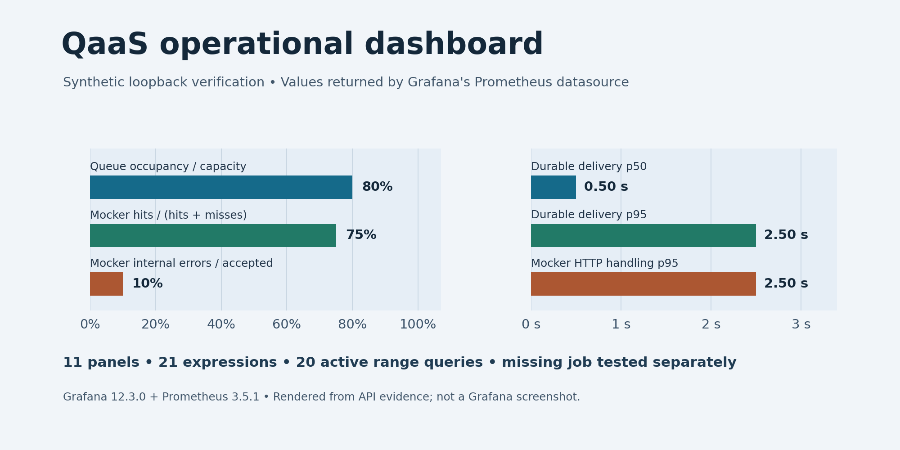

# QaaS operations dashboard

**Proposed and optional.** Keep the existing QaaS logs → Elasticsearch → Grafana path for adoption and evidence. This supplemental Prometheus dashboard describes an operational producer that has not been added to Runner or Mocker. No live data or setup is needed to read these assets.



- Import [dashboard.json](dashboard.json) into Grafana. It expects a Prometheus data source UID of `qaas-prometheus` and scrape job `qaas_operational`. Remap the UID explicitly if yours differs. These are proposed metric names; without instrumentation the dashboard stays empty except for the all-targets-absent indicator.
- [loopback-evidence.json](loopback-evidence.json) contains actual Grafana 12.3.0 and Prometheus 3.5.1 query results against a synthetic fixture in a disposable network namespace containing only loopback. Eleven panels and 21 expressions were provisioned: 20 returned active range values; the expected missing-job signal fired separately when the target was removed. An isolated Chromium attempt did not render the UI, so the figure above is based on the real Grafana API results. No production endpoint, source system, or credentials were used.

## Metric contract

| Proposed family | Type | Boundary |
|---|---|---|
| `qaas_ingest_accepted_total` | Counter | Unique records durably admitted, excluding recognized replays. |
| `qaas_ingest_acknowledged_total` | Counter | First acknowledgment for each admitted record at the chosen durable downstream boundary, not a transmit attempt. |
| `qaas_ingest_refused_total` | Counter | Attempted records refused before admission. A later retry can succeed; not a unique-record loss count. |
| `qaas_ingest_dropped_total` | Counter | Definitive post-admission discard. Do not count retries, deduplication or unrelated refusal. Keep absent if this boundary cannot be observed. |
| `qaas_ingest_queue_size`, `qaas_ingest_queue_capacity` | Gauges | Depth and finite capacity in records from the same owning scrape target. A zero/missing capacity hides the pressure ratio, not the observed depth. |
| `qaas_ingest_last_accepted_timestamp_seconds` | Gauge | Unix seconds of latest accepted record. Never seen, missing, future timestamp, and unreachable target do not generate valid freshness. An old timestamp is not by itself a failure during expected idle. |
| `qaas_ingest_delivery_duration_seconds` | Classic histogram, optional | Trustworthy measured admission-to-first-durable-ack latency for timed records only. Do not substitute HTTP latency or untrustworthy cross-host time. |
| `qaas_mocker_requests_accepted_total` | Counter | HTTP requests entering the instrumented handling boundary, excluding readiness probes and unrelated rejects. |
| `qaas_mocker_requests_completed_total{outcome}` | Counter | One of `hit` (matched behavior served), `miss` (no match), or `error` (internal handling failure, takes precedence). A configured matching HTTP 404 is still a hit. |
| `qaas_mocker_request_duration_seconds` | Classic histogram, optional | Handling time measured with an in-process monotonic clock for observed terminal HTTP attempts. Not network RTT. |

Each matching histogram uses eight fixed finite upper bounds (`0.05, 0.1, 0.25, 0.5, 1, 2.5, 5, 15` seconds) plus +Inf, sum, and count = 11 series. The fully populated proposed producer emits **33 application series per independently owning scrape target**: 18 ingestion and 15 Mocker. This excludes Prometheus-generated scrape and infrastructure series. Never label with run, case, event or user ID; branch/commit; URL, route or HTTP status; configuration paths or dynamic error text. Only bounded outcome and histogram bounds come from the fixture; Prometheus adds `job` and `instance`. Deduplicate shared queue owners or use one reporter.

## Interpretation

Rates are per second over five minutes, not audited lifetime totals. An admission/acknowledgment gap can be queued work; it is not a drop measurement. Independent expected-traffic/freshness signals are needed to classify an outage, and `absent(up{...})` only detects loss of all scrape identities, not one missing target among survivors. Histogram quantiles are approximate and require identical aggregation buckets; no measured observations mean No data, not zero latency.

Mocker hit share uses `hits/(hits+misses)`. Internal-error share uses `errors/all accepted`, not errors/completed. Both suppress zero or missing denominators. Initialize the three outcomes with known zero where the family is supported; absent instrumentation is not a zero. Short windows may cross distinct admitted/completed cohorts; use durable records for exact correlation. The dashboards do not calculate unique users, projects, tests or runs.

Collector built-ins describe the collector's own boundary. Confirm the release's actual receiver/span/metric-point/exporter metric names, suffixes, units, and labels before mapping anything; collector acceptance is not necessarily durable application acceptance. See [Collector internal telemetry](https://opentelemetry.io/docs/collector/internal-telemetry/) and [Prometheus instrumentation](https://prometheus.io/docs/practices/instrumentation/).

## Reproduce locally

Use Python 3.10+, official Grafana and Prometheus/Promtool. The generator, synthetic fixture, and tests use Python standard library; the optional figure requires Matplotlib. Do not run this against a live deployment.

```sh
python3 -B generate.py
PYTHONDONTWRITEBYTECODE=1 python3 -m unittest -v
promtool test rules promql.test.yml
QAAS_PARENT_NET_NS="$(readlink /proc/self/ns/net)" PYTHONDONTWRITEBYTECODE=1 \
  timeout 90s unshare --kill-child --user --map-root-user --net --fork python3 verify.py \
    --prometheus /absolute/path/to/prometheus --grafana-home /absolute/path/to/grafana-home \
    --result /tmp/qaas-operations-evidence.json
python3 render_evidence.py --input /tmp/qaas-operations-evidence.json --output /tmp/qaas-operations.png
```

Four local Python tests and 48 Promtool assertions across four scenarios passed. The runtime writes to private disposable state, refuses to overwrite existing evidence, and stops its owned processes. The optional `--grafana-screenshot` requires Playwright and Chromium working inside the same network namespace; failure does not invalidate API evidence.
